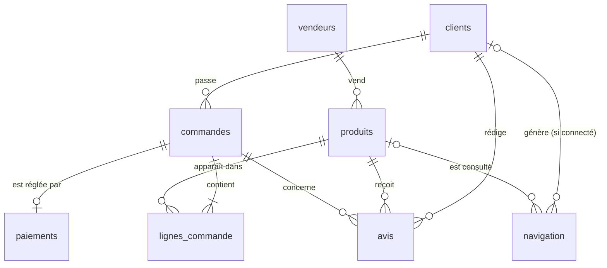

# Contrat de données — SenMarket

Ce document décrit exactement ce que contiennent les huit tables de SenMarket : colonnes, types, clés,
relations, unités et règles métier. Toute la suite du parcours (Modules 1 à 4) s'appuie dessus.
En cas de doute, **c'est ce document qui fait foi**, pas le code.

Les données sont synthétiques : elles ne représentent ni des transactions réelles ni des statistiques officielles.

## 1. Les trois décisions fondatrices

**Granularité.** Une ligne de `commandes` est une commande (un panier) ; une ligne de `lignes_commande`
est un produit dans une commande. Le montant d'une commande est donc toujours la **somme de ses lignes**,
jamais la valeur d'une seule ligne.

**Identifiants.** Chaque entité a un identifiant texte stable, formé d'un préfixe de trois lettres et de
sept chiffres (`CLI0000001`). Un nom n'est jamais une clé : deux clients homonymes seraient fusionnés à tort.

**Prix.** Le prix de catalogue vit dans `produits.prix_catalogue_xof` ; le prix réellement payé vit dans
`lignes_commande.prix_unitaire_xof`. Les deux peuvent différer (promotion jusqu'à ±10 %), ce qui permet de
modifier le catalogue sans réécrire l'historique des ventes.

## 2. Conventions générales

| Sujet | Règle |
|---|---|
| Monnaie | Franc CFA (XOF), **entiers uniquement** : le franc CFA n'a pas de centimes. Les colonnes monétaires finissent par `_xof`. |
| Dates | Format ISO `AAAA-MM-JJ` ; horodatages `AAAA-MM-JJ HH:MM:SS`. Aucune date postérieure à `--run-date`. |
| Valeurs codées | En minuscules, sans accent, mots séparés par `_` (`orange_money`, `en_attente`). Une valeur hors liste est invalide. |
| Encodage | Tous les fichiers en UTF-8. |
| Facultatif | Une colonne marquée « facultatif » peut être vide ; toutes les autres sont obligatoires. |
| Identifiants | Préfixe + 7 chiffres, complétés par des zéros à gauche. Uniques dans leur table. |

## 3. Schéma des relations

Ordre de dépendance (création et nettoyage) : `clients`, `vendeurs` → `produits` → `commandes` →
`lignes_commande`, `paiements`, `avis` → `navigation`.

## 4. Les tables

### 4.1 `clients` — un client inscrit

| Colonne | Type | Clé / Contrainte | Règle |
|---|---|---|---|
| `client_id` | texte | **PK**, `CLI` + 7 chiffres | unique, jamais vide |
| `nom_client` | texte | obligatoire | prénom et nom sénégalais, accents conservés ; vide → « Inconnu » |
| `email` | texte | facultatif | synthétique ; donnée personnelle (masquée au Module 10) |
| `telephone` | texte | facultatif | format `+221 7x xxx xx xx` ; donnée personnelle |
| `ville` | texte | obligatoire | une vingtaine de villes ; vide → « Inconnue » |
| `region` | texte | obligatoire | une des 14 régions (§ 5), cohérente avec la ville ; vide → « Inconnue » |
| `date_inscription` | date | obligatoire | ≤ `--run-date` |

### 4.2 `vendeurs` — une boutique partenaire

| Colonne | Type | Clé / Contrainte | Règle |
|---|---|---|---|
| `vendeur_id` | texte | **PK**, `VEN` + 7 chiffres | unique |
| `nom_vendeur` | texte | obligatoire | |
| `ville` | texte | obligatoire | |
| `region` | texte | obligatoire | cohérente avec la ville |

### 4.3 `produits` — un article du catalogue

| Colonne | Type | Clé / Contrainte | Règle |
|---|---|---|---|
| `produit_id` | texte | **PK**, `PRD` + 7 chiffres | unique |
| `nom_produit` | texte | obligatoire | |
| `categorie` | texte codé | obligatoire | une des catégories du § 5 |
| `vendeur_id` | texte | **FK → vendeurs** | le vendeur doit exister et être accepté |
| `prix_catalogue_xof` | entier | obligatoire | généré entre 1 000 et 500 000 ; rejet si ≤ 0 ou > 1 000 000 |
| `actif` | booléen | obligatoire | `True` si le produit est encore en vente |

### 4.4 `commandes` — un panier validé

| Colonne | Type | Clé / Contrainte | Règle |
|---|---|---|---|
| `commande_id` | texte | **PK**, `CMD` + 7 chiffres | unique |
| `client_id` | texte | **FK → clients** | |
| `date_commande` | date | obligatoire | dans les `--jours` jours avant `--run-date` ; ≥ `date_inscription` du client ; jamais future |
| `statut` | texte codé | obligatoire | `livree`, `expediee`, `en_cours`, `annulee` |

### 4.5 `lignes_commande` — un produit dans une commande

| Colonne | Type | Clé / Contrainte | Règle |
|---|---|---|---|
| `ligne_commande_id` | texte | **PK**, `LIG` + 7 chiffres | unique |
| `commande_id` | texte | **FK → commandes** | une commande a au moins une ligne |
| `produit_id` | texte | **FK → produits** | |
| `quantite` | entier | obligatoire | > 0 ; générée entre 1 et 5 (1 : 55 %, 2 : 25 %, puis décroissant) |
| `prix_unitaire_xof` | entier | obligatoire | **prix payé** ; entre 90 % et 110 % du prix catalogue ; rejet si ≤ 0 ou > 1 000 000 |
| `montant_xof` | entier | obligatoire | **= `quantite` × `prix_unitaire_xof`** ; vide → recalculé |

### 4.6 `paiements` — le règlement d'une commande

| Colonne | Type | Clé / Contrainte | Règle |
|---|---|---|---|
| `paiement_id` | texte | **PK**, `PAI` + 7 chiffres | unique |
| `commande_id` | texte | **FK → commandes** | au plus un paiement par commande |
| `methode_paiement` | texte codé | obligatoire | `wave` (~45 %), `orange_money` (~35 %), `carte` (~8 %), `especes` (~12 %) |
| `statut_paiement` | texte codé | obligatoire | `reussi` (~90 %), `echoue` (~6 %), `en_attente` (~4 %) |
| `montant_xof` | entier | obligatoire | ≥ 0 ; égal en général à la somme des lignes de la commande |
| `date_paiement` | date | obligatoire | ≥ `date_commande` et ≤ `--run-date` *(décision du projet)* |

**Écarts métier volontaires (à ne pas mettre en quarantaine)** : ~2 % des commandes n'ont aucun paiement ;
~1 % des paiements ont un montant différent de la somme des lignes (frais, remise). Ce sont des réalités du
commerce, exploitées par la finance au Module 1.

### 4.7 `avis` — la note laissée par un client

| Colonne | Type | Clé / Contrainte | Règle |
|---|---|---|---|
| `avis_id` | texte | **PK**, `AVI` + 7 chiffres | unique |
| `client_id` | texte | **FK → clients** | = le client de la commande |
| `produit_id` | texte | **FK → produits** | un produit présent dans cette commande |
| `commande_id` | texte | **FK → commandes** | commande au statut `livree` uniquement |
| `note` | entier | obligatoire | entre 1 et 5 |
| `date_avis` | date | obligatoire | ≥ `date_commande` et ≤ `--run-date` |

### 4.8 `navigation` — un événement sur le site

| Colonne | Type | Clé / Contrainte | Règle |
|---|---|---|---|
| `evenement_id` | texte | **PK**, `NAV` + 7 chiffres | unique |
| `session_id` | texte | obligatoire, `SES` + 7 chiffres *(décision du projet)* | regroupe les événements d'une visite ; n'est pas une clé |
| `client_id` | texte | **FK → clients**, facultatif | vide pour ~30 % des sessions (visiteurs anonymes) |
| `produit_id` | texte | **FK → produits**, facultatif | |
| `type_evenement` | texte codé | obligatoire | `vue_produit` → `ajout_panier` → `debut_paiement`, dans cet ordre au sein d'une session |
| `date_evenement` | horodatage | obligatoire | ≤ `--run-date` |

Entonnoir attendu : environ 15 % des sessions atteignent `debut_paiement`.

**Colonnes volontairement absentes** : `stock`, `commentaire` et `reference_transaction` n'existent pas encore.
Le Module 1 les crée lui-même ; ne pas les ajouter.

## 5. Listes de référence

**Régions (14)** : Dakar, Diourbel, Fatick, Kaffrine, Kaolack, Kédougou, Kolda, Louga, Matam, Saint-Louis,
Sédhiou, Tambacounda, Thiès, Ziguinchor. Valeur d'imputation : « Inconnue ».

**Catégories de produits (7)** *(décision du projet)* : `telephonie`, `mode_tissus`, `alimentation`, `maison`,
`electromenager`, `beaute`, `informatique`.

## 6. Volumes attendus pour `--rows N`

`N` est le nombre de lignes de commande.

| Table | Volume | Pour N = 10 000 |
|---|---|---|
| `lignes_commande` | N | 10 000 |
| `commandes` | ≈ N / 2,5 | ≈ 4 000 |
| `clients` | ≈ N / 3 | ≈ 3 333 |
| `vendeurs` | 20 | 20 |
| `produits` | 40 | 40 |
| `paiements` | ≈ 98 % des commandes | ≈ 3 920 |
| `avis` | ≈ N / 10 | ≈ 1 000 |
| `navigation` | ≈ 2 N | ≈ 20 000 |

⚠️ **Point ouvert à faire trancher par le formateur** : le module indique à la fois « environ N/10 avis » et
« des avis sur ~10 % des commandes livrées ». Pour N = 10 000, la seconde règle donne au plus 400 avis
(10 % de 4 000 commandes), soit bien moins que 1 000. Choix retenu en attendant : *(à compléter)*.

## 7. Règles de validation (utilisées au nettoyage, chapitre 4)

| Règle | Tables | Motif de rejet |
|---|---|---|
| Clé primaire présente et unique | toutes | `cle_primaire_absente:<cle>`, `doublon_exact`, `cle_primaire_conflit:<cle>` |
| Clé étrangère vers une ligne parente **acceptée** | toutes les tables filles | `cle_etrangere_invalide:<colonne>` (effet cascade) |
| Champ obligatoire non imputable présent | toutes | `champ_obligatoire_absent:<colonne>` |
| Date lisible et non future | clients, commandes, paiements, avis, navigation | `date_invalide:<colonne>`, `date_future:<colonne>` |
| Quantité > 0 | lignes_commande | `quantite_invalide` |
| 0 < prix unitaire ≤ 1 000 000 | lignes_commande | `prix_unitaire_invalide`, `prix_unitaire_outlier` |
| Montant numérique et = quantité × prix | lignes_commande | `montant_non_numerique`, `montant_incoherent` |
| Montant de paiement ≥ 0 | paiements | `montant_paiement_invalide` |
| Note entre 1 et 5 | avis | `note_hors_intervalle` |
| 0 < prix catalogue ≤ 1 000 000 | produits | `prix_catalogue_non_positif_ou_invalide`, `prix_catalogue_outlier` |

Corrections sans rejet : montants écrits en texte (« 45 000 FCFA ») convertis en entier ; noms à l'encodage
abîmé réparés ; montant de ligne manquant recalculé ; ville, région et nom manquants étiquetés « Inconnue » /
« Inconnu ». Une ligne rejetée n'est jamais effacée : elle est conservée avec son motif.

## 8. Questions du ticket SM-002

1. *Pourquoi l'argent est-il stocké en entier et pas en décimal ?* — (ta réponse, 3 phrases maximum)
2. *Pourquoi `montant_xof` existe-t-il à la fois dans `lignes_commande` et dans `paiements` ? Qui fait foi en cas d'écart ?* — (ta réponse)
